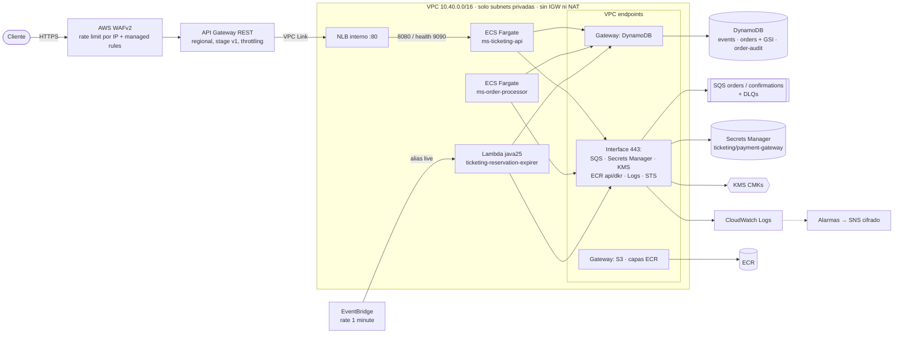

# Ticketing Infra

Infraestructura como código (Terraform) de la plataforma de ticketing
([ticketing-platform](https://github.com/DaniBonica001/ticketing-platform)) en AWS (`us-east-1`).
El entorno `envs/local` se aplica contra LocalStack 4.14 con `tflocal`; `envs/prod` es la composición
completa para AWS y se valida estáticamente (`terraform validate` + checkov).

Los nombres de recursos, puertos y variables de entorno son los de
`ticketing-platform/docs/design/conventions.md` (contrato vinculante entre ambos repos).

## 1. Arquitectura



Flujo: la API valida el JWT, escribe en DynamoDB y encola en SQS (202); el processor consume ambas
colas; la Lambda corre cada minuto, expira reservas y reconcilia órdenes atascadas (ADR-0001/0003/0005).

## 2. Estructura y catálogo de módulos

```
modules/
  network/            VPC privada, subnets por AZ, endpoints + políticas, SGs, flow logs
  kms/                CMK con rotación, alias y key policy (delegación IAM + servicios)
  dynamodb/           Tabla on-demand, PITR, SSE-CMK, deletion protection, GSIs
  sqs-queue/          Cola estándar + DLQ (ADR-0003) y queue policies (TLS, VPCE, productor/consumidor)
  secrets/            Secreto sin valor + resource policy (solo lectores, solo vía VPCE)
  iam-role/           Rol por componente: trust con aws:SourceAccount + política inline
  component-policies/ Políticas de mínimo privilegio de api/processor/expirer (compartidas local/prod)
  ecs-cluster/        Cluster Fargate, Container Insights, FARGATE + FARGATE_SPOT, ECS Exec auditado
  ecs-service/        Task definition endurecida + servicio + autoscaling (CPU y métrica por tarea)
  lambda-scheduled/   Lambda + alias live + EventBridge rate(1 minute) + destino de fallos + permiso
  api-edge/           REST API + VPC Link + NLB interno + WAFv2 + logs de acceso y de WAF
  observability/      Alarmas, topic SNS cifrado y dashboard
  budget/             AWS Budget mensual con notificaciones
envs/
  local/              LocalStack (tflocal): kms, dynamodb, sqs, secrets, iam, lambda, eventbridge, logs, sns
  prod/               Composición completa, backend S3 con use_lockfile
bootstrap/
  state-backend/      Bucket S3 de estado (versionado, KMS, TLS-only, sin acceso público)
```

Cada módulo tiene `main.tf`, `variables.tf` (con descripciones y `validation`), `outputs.tf`,
`versions.tf` y un `README.md`. Los entornos fijan el provider `hashicorp/aws ~> 6.0` en
`.terraform.lock.hcl` (6.69.1, hashes para darwin/linux amd64/arm64).

## 3. Cómo ejecutar

### Local (LocalStack + tflocal)

```bash
# LocalStack propio (no choca con otros stacks en 4566-4599)
docker run -d --name tf-localstack -p 127.0.0.1:4966:4566 \
  -v /var/run/docker.sock:/var/run/docker.sock localstack/localstack:4.14.0

export AWS_ENDPOINT_URL=http://127.0.0.1:4966 AWS_ACCESS_KEY_ID=test AWS_SECRET_ACCESS_KEY=test \
       AWS_DEFAULT_REGION=us-east-1

# Paquete de la Lambda: el real del repo de la aplicación o un zip placeholder
mkdir -p /tmp/expirer && echo placeholder > /tmp/expirer/README.txt && (cd /tmp/expirer && zip -q ../expirer.zip README.txt)

cd envs/local
tflocal init
tflocal apply -var lambda_package_path=/tmp/expirer.zip
awslocal dynamodb list-tables && awslocal sqs list-queues
tflocal destroy -var lambda_package_path=/tmp/expirer.zip
docker rm -f tf-localstack
```

`provider "aws"` fija `allowed_account_ids = ["000000000000"]`: si por error se ejecuta con
credenciales reales, Terraform falla antes de tocar nada.

### Producción

1. **Bootstrap del backend (una vez por cuenta)**: `cd bootstrap/state-backend && terraform init &&
   terraform apply -var 'allowed_account_ids=["<prod-account>"]'`. Crea
   `ticketing-tfstate-<account>-<region>` (versionado, SSE-KMS, TLS-only, `prevent_destroy`).
2. `cd envs/prod && cp backend.hcl.example backend.hcl && cp terraform.tfvars.example terraform.tfvars`
   (ambos fuera de git) y completar.
3. `terraform init -backend-config=backend.hcl` → `terraform plan -out=prod.tfplan` → `terraform apply prod.tfplan`.
   El bloqueo de estado usa el lockfile nativo de S3 (`use_lockfile = true`), sin tabla DynamoDB.
4. Cargar el secreto fuera de banda:
   `aws secretsmanager put-secret-value --secret-id ticketing/payment-gateway --secret-string file://pg.json`.
5. CI publica las imágenes en ECR y despliega por **digest** (`api_image`, `processor_image`).

## 4. Decisiones

### Red
- **Solo subnets privadas** (una `/20` por AZ, 3 AZs fijadas explícitamente), **sin IGW ni NAT**: los
  workloads no tienen ruta a internet; la única entrada es API Gateway.
- **VPC endpoints**: gateway para DynamoDB y S3 (gratis); interface con private DNS para SQS, Secrets
  Manager, KMS, ECR api/dkr, Logs y STS. Políticas de endpoint: DynamoDB solo tablas `ticketing-*`;
  S3 solo el bucket de capas de ECR; interface solo acciones del propio servicio, principales de la
  cuenta y (sqs/secretsmanager/kms/logs) recursos de la cuenta — mitiga exfiltración hacia otras cuentas.
- **Security groups** de mínimo privilegio con reglas separadas: NLB→API 8080 (+9090 para el health check
  de actuator); API/processor/Lambda→endpoints 443 y →prefix lists de DynamoDB/S3 443; el SG de endpoints
  solo acepta 443 desde los SGs de la app; el SG por defecto queda sin reglas.
- **Pasarela de pago:** sin NAT no hay salida a internet. El processor solo sale a `payment_gateway_cidrs`
  (ENIs de un endpoint PrivateLink del proveedor o una VPC de egress centralizada con firewall vía TGW);
  nunca `0.0.0.0/0` (validado).
- **REST API y no HTTP API**: WAF solo se asocia a stages de REST API. El VPC Link (v1) exige NLB.
- **Flow logs** (ALL) cifrados, retención 1 año.

### Seguridad
- **JWT** validado en el servicio (RS256, `iss`/`aud`/`exp`), defensa en profundidad. Opción de producción:
  `cognito_user_pool_arns` agrega un authorizer Cognito en el borde.
- **WAFv2**: regla rate-based por IP (ventana 5 min) + `AmazonIpReputationList`, `KnownBadInputs`
  (incluye Log4JRCE) y `CommonRuleSet`. Logs con el header `Authorization` redactado.
- **Cifrado**: 4 CMKs con rotación (`data`, `messaging`, `secrets`, `observability`). Las key policies
  delegan en IAM y los roles usan cada llave solo vía el servicio (`kms:ViaService`).
- **Colas**: deny sin TLS; `SendMessage` solo productores, `Receive/Delete/ChangeVisibility` solo el
  processor (deny explícito para cualquier otro principal salvo roles break-glass); los roles de la app
  solo pueden acceder vía el VPC endpoint (`aws:SourceVpce`). La DLQ solo acepta redrive de su cola.
- **Secreto** sin valor en código/estado; solo el processor puede leerlo y solo vía el endpoint.
- **IAM**: un rol por componente y roles de ejecución ECS separados. Comodines solo donde AWS lo exige
  (`ecr:GetAuthorizationToken`, ENIs de Lambda en VPC, X-Ray), comentados. Permissions boundary opcional.
- **Contenedores**: root FS de solo lectura (solo `/tmp` efímero), usuario no root `10001`, capacidades
  Linux eliminadas, imágenes por digest en ECR inmutable con scan on push, ECS Exec deshabilitado.
- **Guardarraíles**: `allowed_account_ids` en cada provider, deletion protection en tablas y NLB.

### Escalabilidad
- API: target tracking por CPU y por **peticiones de API Gateway por tarea** (métrica matemática
  `Count / RunningTaskCount`). Throttling de stage (rate/burst) y WAF como primera barrera.
- Processor: target tracking por CPU y por **backlog por tarea** de cada cola
  (`ApproximateNumberOfMessagesVisible / RunningTaskCount`, patrón "backlog per instance" de AWS): una
  pasarela lenta escala por confirmaciones sin frenar reservas.
- Lambda con `reserved concurrency = 1` (los barridos nunca se solapan; ADR-0005).
- DynamoDB on-demand: absorbe picos sin planificar capacidad. Los límites de ítem caliente están en
  `dynamodb.md` §5 y tienen alarma de throttling.

### Aislamiento de entornos
- Estrategia: **una cuenta AWS por entorno** (dev, staging, prod) bajo AWS Organizations, con SCPs y
  `allowed_account_ids` por entorno; **un estado por entorno** (bucket de estado por cuenta, key
  `ticketing/<env>/terraform.tfstate`). `envs/prod` sirve de plantilla: dev/staging son copias con su
  `backend.hcl` y `terraform.tfvars` (`environment`, `az_count = 2`, mínimos de autoscaling menores,
  `deletion_protection_enabled = false` solo en dev).
- Los módulos no conocen el entorno; todo llega por variables. `envs/local` usa los mismos módulos y las
  mismas políticas IAM (`component-policies`), con estado local y desechable.

### Costo
- **Endpoints vs NAT**: 7 interface endpoints × 3 AZ ≈ 0,21 USD/h (~150 USD/mes) + 0,01 USD/GB, frente a
  3 NAT ≈ 0,135 USD/h (~100 USD/mes) + 0,045 USD/GB. Con poco tráfico el NAT es algo más barato; se
  eligen endpoints por **seguridad** (sin salida a internet) y porque el costo por GB es 4,5× menor en
  picos. Palanca: `az_count = 2` en dev/staging. Los gateway endpoints (DynamoDB/S3) son gratis.
- DynamoDB **on-demand** (sin capacidad ociosa) y Lambda en vez de un servicio 24/7 (~1 440 invocaciones/día).
- **Fargate Spot** para el processor (peso 3, base on-demand 2): es seguro porque los mensajes se
  reentregan y los consumidores son idempotentes. Graviton (`ARM64`) por defecto (~20 % más barato).
- Sin cache de API Gateway (costo fijo y datos que deben ser frescos). Retención de logs 1 año en prod,
  7 días en local. AWS Budget mensual con avisos al 80 %/100 % real y 100 % proyectado.

### Gobierno
- `default_tags`: `Project`, `Environment`, `Owner`, `CostCenter`, `ManagedBy=terraform`, `Repository`.
- Escaneo estático con **checkov**: 0 hallazgos abiertos; cada supresión está en línea con su justificación
  (`#checkov:skip=<id>:<motivo>`).
- Validaciones en variables (digest de imagen, CIDRs, retenciones válidas, nombres con prefijo).
- Nunca se versionan estado, planes ni tfvars reales (`.gitignore`).

## 5. Observabilidad

| Alarma | Condición |
|---|---|
| `<dlq>-not-empty` | DLQs y destino de fallos de la Lambda con ≥ 1 mensaje |
| `<cola>-oldest-message-age` | `ApproximateAgeOfOldestMessage` > 60 s (orders) / 120 s (confirmations) |
| `ticketing-reservation-expirer-errors` / `-throttles` | > 0 durante 3 min |
| `ticketing-api-5xx` / `-latency-p99` | 5XX > 5/min; p99 > 1 000 ms |
| `<tabla>-throttles` | eventos de throttling de lectura + escritura > 0 |

Todas notifican a un topic SNS cifrado; dashboard `ticketing-overview`.

## 6. Limitaciones de LocalStack (4.14 community)

| Recurso | Local | Prod |
|---|---|---|
| KMS, DynamoDB (+GSI, PITR, SSE), SQS + DLQ + policies, Secrets Manager, IAM | aplicado | aplicado |
| Lambda java25 + alias + destino de fallos, EventBridge rule/target/permiso | aplicado (schedule `DISABLED` por defecto) | aplicado |
| CloudWatch Logs, SNS, dashboard | aplicado | aplicado |
| CloudWatch **alarmas** | solo validado (`create_alarms = false`) | aplicado |
| VPC, endpoints, SGs, flow logs | solo validado | aplicado |
| ECS, ECR, ELBv2 (NLB), WAFv2, API Gateway VPC Link, Budgets | solo validado (servicios Pro / no emulados) | aplicado |

- **Alarmas**: LocalStack crea la alarma (`PutMetricAlarm`), pero `DescribeAlarms` sobre el protocolo
  CBOR (`smithy-rpcv2-cbor`) que usa el provider 6.x responde 500 ("unknown error ... serialize the
  response"); el provider reintenta hasta el timeout. Por eso `envs/local` usa `create_alarms = false`.
- Las condiciones `aws:SourceVpce`, el `kms:ViaService` y las queue/secret policies no se evalúan en
  LocalStack: allí el aislamiento real lo dan las redes Docker del repo de la aplicación.
- El schedule de EventBridge queda deshabilitado localmente para no arrancar un contenedor java25 cada
  minuto con un zip placeholder (`expirer_schedule_enabled = true` con el zip real).
- SnapStart está apagado en local (no se emula) y en prod por defecto (recomendación del equipo de la
  Lambda: la regla de 1 minuto la mantiene caliente); `lambda_snapstart_enabled` lo habilita tras
  confirmar el soporte de `java25` en la región.
- LocalStack no persiste `RecoveryPeriodInDays` de PITR ni devuelve `KMSKeyArn` de la Lambda, lo que
  generaba un diff perpetuo: en local la ventana de PITR usa el valor por defecto del servicio y las
  variables de entorno de la Lambda usan la llave administrada por AWS (en prod, CMK).
- LocalStack devuelve `RedriveAllowPolicy: ""` en vez de omitirlo, y el `aws_sqs_queue_redrive_allow_policy`
  separado quedaba esperando indefinidamente al destruir; por eso la política va en línea en la DLQ.
- Resultado verificado: `tflocal apply` crea 39 recursos, un segundo `plan` no muestra cambios y
  `tflocal destroy` elimina los 39.
- `terraform plan` de prod requiere credenciales de la cuenta: aquí solo se ejecuta `validate`.

## 7. Contrato con la aplicación

| Variable de entorno | Origen |
|---|---|
| `EVENTS_TABLE` / `ORDERS_TABLE` / `AUDIT_TABLE` | `ticketing-events` / `ticketing-orders` / `ticketing-order-audit` |
| `ORDERS_QUEUE_URL` / `CONFIRMATIONS_QUEUE_URL` | outputs de `sqs-queue` (API, processor y Lambda) |
| `PAYMENT_GATEWAY_SECRET_ID` | `ticketing/payment-gateway` (processor) |
| `JWT_ISSUER` / `JWT_AUDIENCE` / `JWT_PUBLIC_KEY_LOCATION` | variables de `envs/prod` (API) |
| `OTEL_SERVICE_NAME` | nombre del componente |

Requisitos para las imágenes: corren como UID/GID `10001`, con root FS de solo lectura (solo `/tmp`
escribible), compiladas para `ARM64` (o `cpu_architecture = "X86_64"`), API en 8080 y actuator
`/actuator/health/readiness` en 9090. La Lambda no define `AWS_REGION` (variable reservada) y usa el
handler `com.dbonilla.ticketing.expirer.lambda.ExpirerHandler::handleRequest`.
